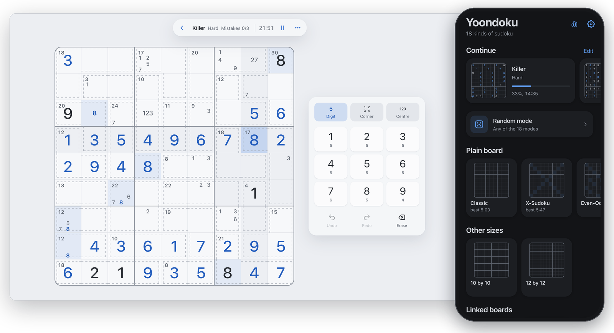

# Yoondoku

Eighteen kinds of sudoku in the browser. No accounts, no ads, no build step.

[yoonzky.github.io/yoondoku](https://yoonzky.github.io/yoondoku/)



## Modes

| Group | Modes |
|---|---|
| Plain board | Classic, X-Sudoku, Even-Odd, Windoku, Asterisk, Mosaic |
| Other sizes | 10x10, 12x12 |
| Linked boards | Double, Wing, Butterfly, Samurai |
| Extra rules | Killer, Dots, Suguru, Kakuro, Numerator, Tokkidoku |

Every mode has four levels and its own records. Random mode deals one of the modes ticked in its pool.

## Features

- Levels are graded by a solver: Easy needs singles only, Hard needs locked candidates, Expert needs hidden triples and X-wing.
- Every deal has exactly one solution.
- Three ways to fill a cell: digit, corner marks, centre marks.
- Several cells can be picked at once by dragging or with Cmd-click.
- A pad at the cell opens on a double or right click.
- Up to eight unfinished games, each with its own timer.
- Hints, auto-candidates, undo and redo, a three-mistake limit. Each can be switched off.
- Light and dark themes, Russian and English.
- On a phone large boards open magnified, with a minimap.

## Keyboard

| Action | Keys |
|---|---|
| Digit | `1`-`9`, `A` `B` `C` for 10-12 |
| Corner mark | `Shift` + digit |
| Centre mark | `Cmd` / `Ctrl` + digit |
| Input mode | `Z` digit, `X` corner, `C` centre, `Space` next |
| Erase | `Backspace` or `0` |
| Undo, redo | `Cmd` / `Ctrl` + `Z`, `Cmd` / `Ctrl` + `Y` |
| Move | arrow keys |
| Hint, auto-candidates | `H`, `A` |
| Rules, pause, back | `R`, `P`, `Esc` |

## Structure

```
index.html     markup and script order
css/           tokens, base, home, game
js/engine/     core, grade, modes, numerator, kakuro, tokki, worker
js/app/        i18n, store, util, art, sheet, board, game, input, home, main
icons/         site and app icons
```

All modes share one model: cells with coordinates, groups that hold each digit once, pairs that must differ, summed areas, dots and a mask of allowed digits. The solver, the grader and the board drawing work on this model, and a new mode is one entry in `js/engine/modes.js`. Numerator is checked by connectivity and has its own module.

Random parts of a deal (Suguru regions, Killer cages, dots, parity, the Kakuro pattern) are stored with the game, so a reload rebuilds the same board. Games, settings and records are kept in `localStorage`.

## Running locally

```
python3 -m http.server 8000
```

Then open `http://localhost:8000`. Opening `index.html` directly also works; puzzle generation then runs on the main thread.

## License

Copyright (C) 2026 yoonzky. GNU Affero General Public License v3.0, see [LICENSE](LICENSE).

Anyone who copies or changes the code, including running a changed version as a website, has to keep this notice and share the source under the same license.
